# PVPC Planner

Panel para Home Assistant que muestra los precios PVPC por horas y enciende tus dispositivos en las horas que elijas.

<p align="center">
  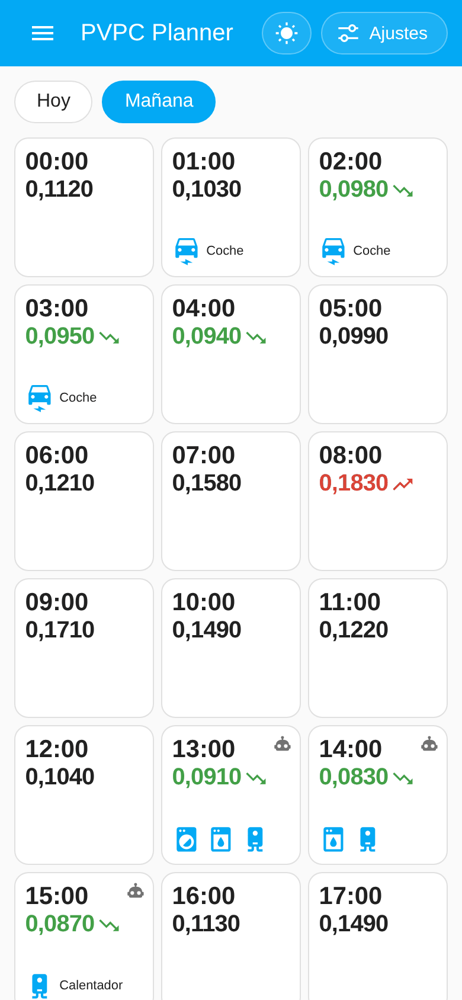
  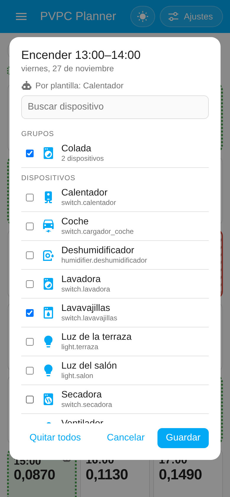
  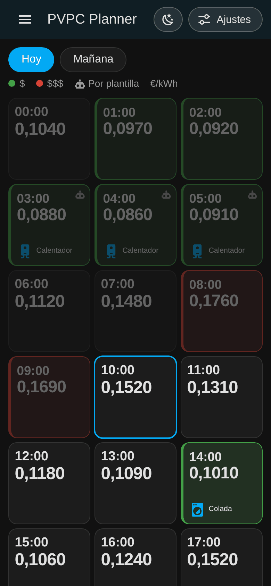
</p>

<sub>Capturas de un entorno simulado con datos de ejemplo.</sub>

## Qué hace

- Muestra los precios PVPC de **hoy** y, cuando REE los publica (hacia las 20:30), los de **mañana**.
- Marca en **verde** las 6 horas más baratas del día y en **rojo** las 6 más caras. Los periodos punta, llano y valle no se tienen en cuenta.
- Al pulsar una hora eliges qué dispositivos deben estar **encendidos** durante esa hora.
- Las **plantillas** marcan horas solas cada día según reglas de precio (p. ej. las 3 horas más baratas).
- Lo marcado a mano es para una fecha concreta y no se repite.
- Interfaz en español, gallego e inglés según el idioma del usuario en Home Assistant (inglés por defecto).

## Requisitos

- Home Assistant 2024.7 o superior.
- [HACS](https://hacs.xyz) para instalarlo como repositorio personalizado.
- La integración oficial [**Spain electricity hourly pricing (PVPC)**](https://www.home-assistant.io/integrations/pvpc_hourly_pricing/) (`pvpc_hourly_pricing`) configurada. De ella salen los precios: este panel no consulta a REE por su cuenta.

  [](https://my.home-assistant.io/redirect/config_flow_start/?domain=pvpc_hourly_pricing)

## Instalación

[](https://my.home-assistant.io/redirect/hacs_repository/?owner=xaimepardal&repository=ha-pvpc-planner&category=integration)

O a mano:

1. En HACS, abre el menú ⋮ → **Repositorios personalizados**.
2. Añade `https://github.com/xaimepardal/ha-pvpc-planner` con el tipo **Integración**.
3. Busca **PVPC Planner**, descárgalo y reinicia Home Assistant.
4. Ve a **Ajustes → Dispositivos y servicios → Añadir integración → PVPC Planner**.
5. Elige el sensor PVPC. Normalmente viene preseleccionado.

[](https://my.home-assistant.io/redirect/config_flow_start/?domain=pvpc_planner)

Aparecerá **PVPC Planner** en la barra lateral.

<details>
<summary>Instalación manual</summary>

Copia `custom_components/pvpc_planner` en la carpeta `config/custom_components/` de tu Home Assistant, reinicia y sigue desde el paso 4.
</details>

## Uso

### A mano

1. Abre **PVPC Planner** en la barra lateral y elige **Hoy** o **Mañana**.
2. Pulsa una hora, marca los dispositivos o grupos y pulsa **Guardar**.
3. Para quitarlos, vuelve a abrir la hora y desmárcalos, o pulsa **Quitar todos**.

<p align="center">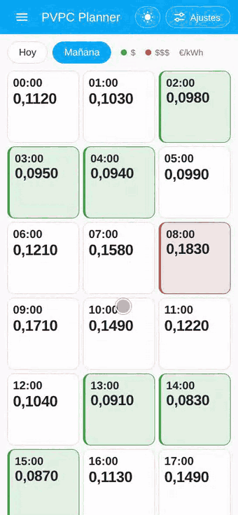</p>

### Con una plantilla

1. **Ajustes → Plantillas → Nueva plantilla**.
2. Elige una o varias reglas. Basta con que se cumpla una:
   - **Horas más baratas del día**: las N más baratas, opcionalmente solo desde la más barata en adelante (y, si queda sola, desde la segunda).
   - **Más barata en una franja**: las N más baratas entre dos horas.
   - **Precio negativo**.
3. Marca qué encender y pulsa **Guardar**.

Las horas se calculan en cuanto se publican los precios y se suman a lo marcado a mano. Se distinguen por el icono del robot.

<p align="center">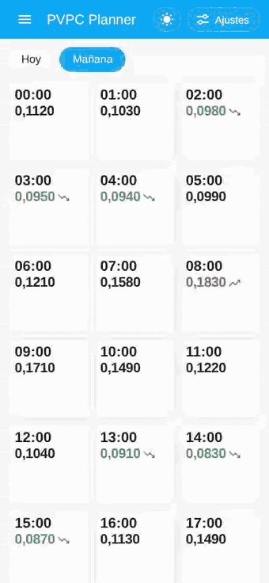</p>

### Ajustes

- **Dispositivos**: ocultar los que no quieras ver al elegir una hora, y cambiar nombre e icono (solo en el panel).
- **Grupos**: varios dispositivos con un nombre y un icono que se encienden y apagan juntos.
- **Plantillas**: ver arriba.

<p align="center">
  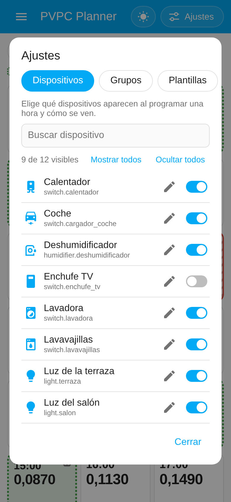
  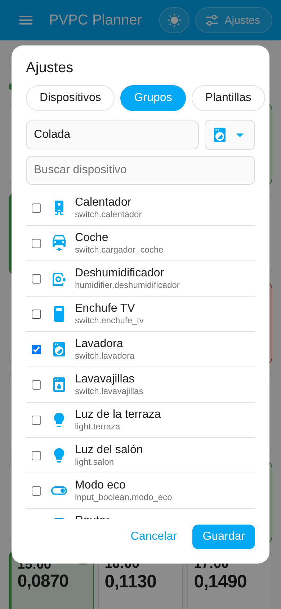
  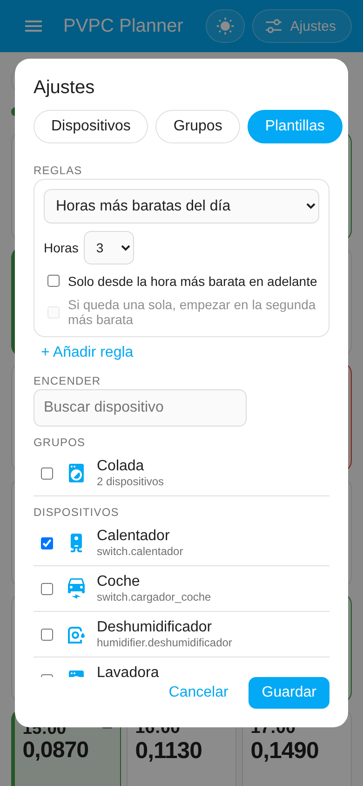
</p>

El botón junto a **Ajustes** alterna entre tema claro y oscuro; por defecto se usa el de Home Assistant y la elección se guarda en el navegador. En pantallas anchas la rejilla muestra 6 horas por fila:

<p align="center">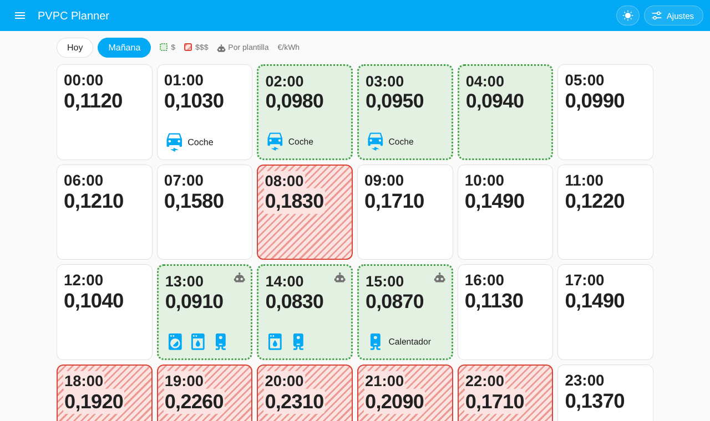</p>

Se pueden programar los tipos de entidad `switch`, `light`, `fan`, `input_boolean` y `humidifier`. Las horas que ya han pasado no se pueden editar, y cada usuario solo puede programar las entidades que tiene permiso para controlar.

### Cuándo se enciende y se apaga

- Al **empezar** una hora marcada, se encienden sus dispositivos.
- Al empezar una hora en la que un dispositivo **ya no está marcado**, se apaga.
- Varias horas marcadas seguidas mantienen el dispositivo encendido sin cortes.
- Si marcas o desmarcas la hora en curso, el cambio se aplica al momento.
- Los dispositivos que el panel no ha encendido no se tocan. Si enciendes algo a mano, el panel no lo apaga.
- Si alguien cambia a mano un dispositivo a mitad de una hora programada, no se vuelve a forzar hasta el siguiente cambio de hora.
- La programación se guarda en Home Assistant, así que funciona con el navegador cerrado y sobrevive a reinicios.

### Imagen para pantallas

Las entidades `image.pvpc_planner_today` y `image.pvpc_planner_tomorrow` dan la tabla del día como PNG, pensada para pantallas e-ink o ESPHome. El precio va en verde con una flecha hacia abajo en las horas baratas y en rojo con una flecha hacia arriba en las caras, así que se lee igual en blanco y negro. Se regenera solo cuando cambian los precios, la programación o la hora en curso.

<p align="center">
  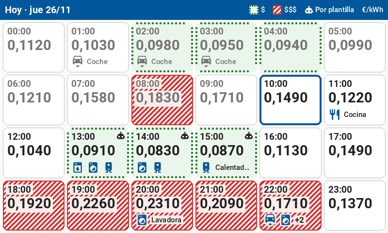
  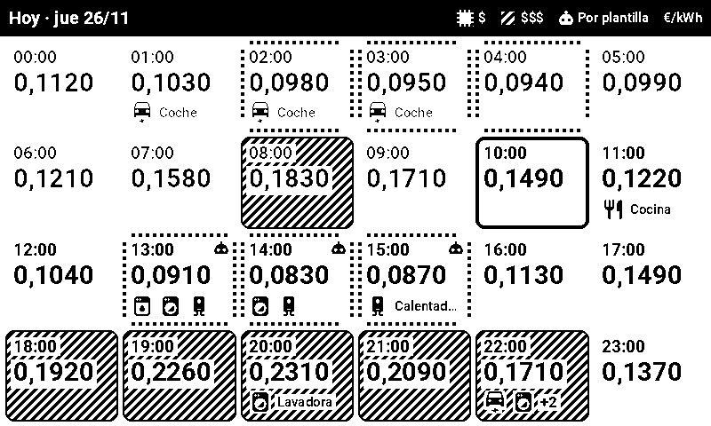
</p>

El tamaño se cambia en **Ajustes → Dispositivos y servicios → PVPC Planner → Configurar** (de 100 a 2000 px; por defecto 800x480). La rejilla se adapta a horizontal o vertical.

Se descarga de `/api/image_proxy/image.pvpc_planner_today` con un token de larga duración, que se crea en **Perfil → Seguridad → Tokens de acceso de larga duración**. Conviene crearlo con un usuario sin permisos de administrador dedicado a la pantalla. Se envía en la cabecera `Authorization: Bearer <token>`. Por ejemplo, con `online_image` de ESPHome (`<ha>` es la dirección de tu Home Assistant):

```yaml
online_image:
  - id: pvpc
    url: http://<ha>:8123/api/image_proxy/image.pvpc_planner_today
    format: PNG
    type: BINARY  # o RGB565 en pantallas de color
    request_headers:
      Authorization: !secret ha_bearer  # "Bearer <token>"
```

### Publicación por MQTT

En la misma pantalla de **Configurar** se puede publicar la imagen de hoy y la de mañana en blanco y negro en un broker MQTT propio, para cualquier pantalla ePaper. Es independiente de la integración MQTT de Home Assistant. Por defecto no se publica nada: hace falta poner el servidor. Al guardar se comprueba la conexión.

- Servidor, puerto (8883) y TLS (activado). La CA es opcional: si la pones, solo se confía en ella.
- Usuario y contraseña. La contraseña no se vuelve a mostrar; si la dejas vacía, se mantiene la guardada.
- Topics `pvpc_planner/image/today` y `pvpc_planner/image/tomorrow`. Si un topic está vacío, esa imagen no se publica.
- Intervalo: cada cuántos minutos se mira si la imagen ha cambiado. Con 60 se publica justo al cambiar la hora.
- Franja activa opcional (desde/hasta, puede cruzar la medianoche): fuera de ella no se publica.

Formato: bitmap del tamaño configurado a 1 bpp (umbral 128, sin tramado, por filas, MSB = píxel izquierdo, 1 = blanco) comprimido con zlib. Se publica con QoS 1 y retenido, así que en el broker queda solo la última imagen de cada topic. Solo se envía cuando cambia, también tras reiniciar Home Assistant. Tras un corte de conexión no se reenvía nada pendiente: solo el estado actual.

## Desarrollo

```bash
pip install -r requirements_test.txt
ruff check . && ruff format --check .
pytest  # incluye cobertura (mínimo 95 %)
```

## Licencia

[MIT](LICENSE)
