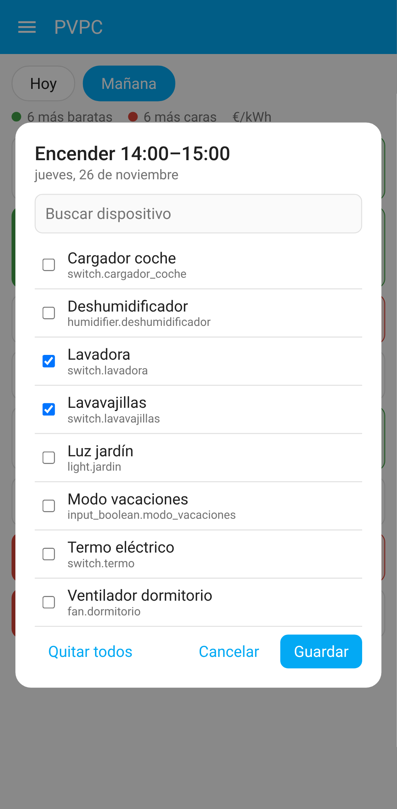
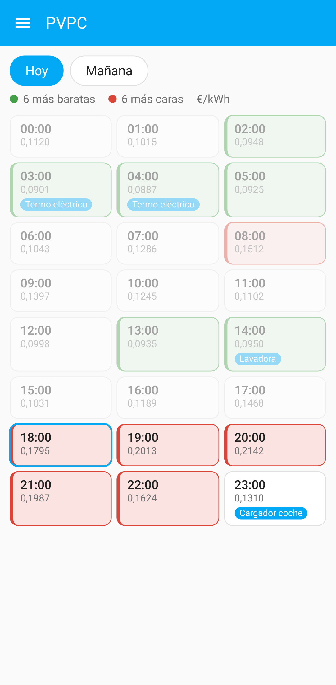
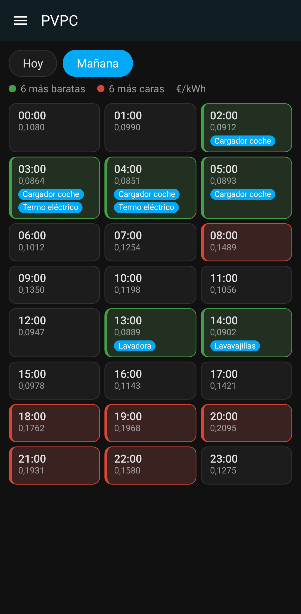

# PVPC Planner

Panel para Home Assistant que muestra los precios PVPC por horas y enciende tus dispositivos en las horas que elijas.

<p align="center">
  
  
  
  
</p>

<sub>Capturas de un entorno simulado en un móvil con datos de ejemplo.</sub>

## Qué hace

- Muestra los precios PVPC de **hoy** y, cuando REE los publica (hacia las 20:30), los de **mañana**.
- Marca en **verde** las 6 horas más baratas del día y en **rojo** las 6 más caras. Los periodos punta, llano y valle no se tienen en cuenta.
- Al pulsar una hora eliges qué dispositivos deben estar **encendidos** durante esa hora.
- La programación es para una fecha concreta y no se repite.
- Interfaz en español, gallego e inglés según el idioma del usuario en Home Assistant (inglés por defecto).

## Requisitos

- Home Assistant 2024.7 o superior.
- [HACS](https://hacs.xyz) para instalarlo como repositorio personalizado.
- La integración oficial [**Spain electricity hourly pricing (PVPC)**](https://www.home-assistant.io/integrations/pvpc_hourly_pricing/) (`pvpc_hourly_pricing`) configurada. De ella salen los precios: este panel no consulta a REE por su cuenta.

  [](https://my.home-assistant.io/redirect/config_flow_start/?domain=pvpc_hourly_pricing)

## Instalación

[](https://my.home-assistant.io/redirect/hacs_repository/?owner=xaimepardal&repository=ha-pvpc-planner&category=integration)

O a mano:

1. En HACS, abre el menú ⋮ → **Repositorios personalizados**.
2. Añade `https://github.com/xaimepardal/ha-pvpc-planner` con el tipo **Integración**.
3. Busca **PVPC Planner**, descárgalo y reinicia Home Assistant.
4. Ve a **Ajustes → Dispositivos y servicios → Añadir integración → PVPC Planner**.
5. Elige el sensor PVPC. Normalmente viene preseleccionado.

[](https://my.home-assistant.io/redirect/config_flow_start/?domain=pvpc_planner)

Aparecerá **PVPC** en la barra lateral.

<details>
<summary>Instalación manual</summary>

Copia `custom_components/pvpc_planner` en la carpeta `config/custom_components/` de tu Home Assistant, reinicia y sigue desde el paso 4.
</details>

## Uso

1. Abre **PVPC** en la barra lateral y elige **Hoy** o **Mañana**.
2. Pulsa la hora en la que quieres encender algo.
3. Marca los dispositivos y pulsa **Guardar**. Aparecerán como etiquetas en esa hora.
4. Para quitar dispositivos, vuelve a abrir la hora y desmárcalos, o pulsa **Quitar todos**.

En **Ajustes** (arriba a la derecha) puedes:

- Ocultar los dispositivos que no quieras ver al elegir una hora, o cambiarles el nombre y el icono (solo en este panel).
- Crear **grupos**: un nombre, un icono y varios dispositivos que se encienden y apagan juntos. Aparecen al pulsar una hora como un dispositivo más.

Junto a **Ajustes** se puede cambiar el tema (claro/oscuro) y el idioma; por defecto se usan los de Home Assistant y la elección se guarda en el navegador.

Se pueden programar los tipos de entidad `switch`, `light`, `fan`, `input_boolean` y `humidifier`. Las horas que ya han pasado no se pueden editar, y cada usuario solo puede programar las entidades que tiene permiso para controlar.

### Cuándo se enciende y se apaga

- Al **empezar** una hora marcada, se encienden sus dispositivos.
- Al empezar una hora en la que un dispositivo **ya no está marcado**, se apaga.
- Varias horas marcadas seguidas mantienen el dispositivo encendido sin cortes.
- Si marcas o desmarcas la hora en curso, el cambio se aplica al momento.
- Los dispositivos que el panel no ha encendido no se tocan. Si enciendes algo a mano, el panel no lo apaga.
- Si alguien cambia a mano un dispositivo a mitad de una hora programada, no se vuelve a forzar hasta el siguiente cambio de hora.
- La programación se guarda en Home Assistant, así que funciona con el navegador cerrado y sobrevive a reinicios.

## Desarrollo

```bash
pip install -r requirements_test.txt
ruff check . && ruff format --check .
pytest  # incluye cobertura (mínimo 95 %)
```

## Licencia

[MIT](LICENSE)
